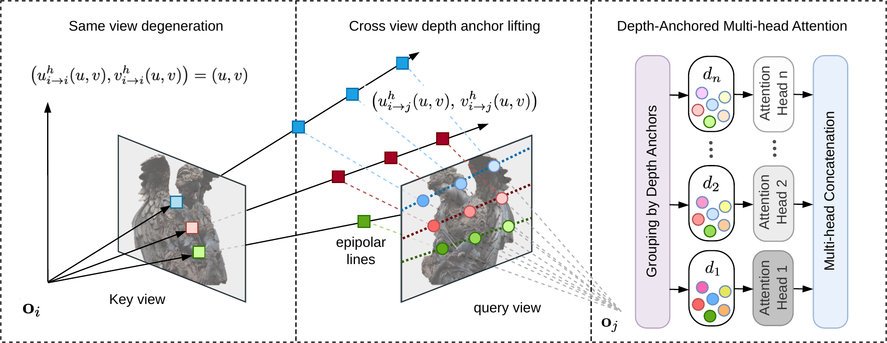
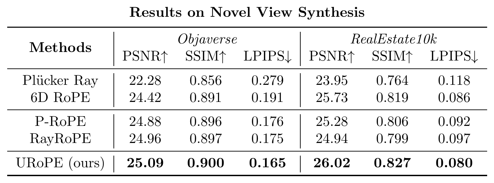

# [ECCV2026] URoPE: Universal Relative Position Embedding across Geometric Spaces

[](https://arxiv.org/abs/2604.18747)
[](https://urope-pe.github.io/)

**TL;DR:** We propose a parameter-free, intrinsics-aware, and SE(3)-invariant relative position embedding for cross-view geometry by explicitly lifting and projection with fixed depth anchors along camera rays.

<br>

<center></center>

<br><br>

This repository shows how to apply different camera conditioning approaches, including [URoPE (ours)](https://arxiv.org/abs/2604.18747), [PRoPE](https://arxiv.org/abs/2507.10496), [2D Axial RoPE](https://arxiv.org/abs/2403.13298) to a [LVSM](https://haian-jin.github.io/projects/LVSM/) model for the task of novel view synthesis. You can reproduce the results of the following table:



## Setup

```
pip install -r requirements.txt 
```

To make sure your setup works, you could run `pytest tests/`.

## Dataset

### RealEstate10K
We first download the [RealEstate10K](https://google.github.io/realestate10k/) dataset using the script [`scripts/gen_imgs.py`](scripts/gen_imgs.py). Then we run [`scripts/gen_transforms.py`](scripts/gen_transforms.py) and [`scripts/data_processes.py`](scripts/data_preprocess.py) to convert the data into our data format.

### Objaverse
We download the rendered dataset from [Zero-1-to-3](https://github.com/cvlab-columbia/zero123). The download command is copied here:

```
wget https://tri-ml-public.s3.amazonaws.com/datasets/views_release.tar.gz
```

You should make the structure of your directory like below:
```
[root]
├── nvs
├── urope
├── data_processed
│   ├── realestate10k
│   │   ├── train
│   │   ├── test
│   ├── objaverse
│   │   ├── views_release
```

## Training

We support training with pixel-aligned camera conditioning (e.g., Plucker raymap, Naive raymap, Camray) or attention-based camera conditioning (e.g., GTA, PRoPE, URoPE) or the combination of them. For example training with `URoPE+Camray` (our recommandation) with 2 GPUs is via:

```
bash ./scripts/nvs.sh --ray_encoding camray --pos_enc urope --gpus "0,1"
```

See `bash ./scripts/nvs.sh  -h` for helper information.

## Validation

The validation on different zooming-in factors can be done via:
 
```
bash ./scripts/nvs.sh --ray_encoding camray --pos_enc prope --gpus "0,1" --test-zoom-in "1 3 5"
```

And different number of input (context) views can be done via:

```
bash ./scripts/nvs.sh --ray_encoding camray --pos_enc prope --gpus "0,1" --test-context-views "2 4 8 16"
```

Or if you simplly want to render some videos out (trajectory is predefined):

```
bash ./scripts/nvs.sh --ray_encoding camray --pos_enc prope --gpus "0,1" --test-render-video
```

## Acknowledgements

This repository is built up on the open-source code of [PRoPE](https://github.com/liruilong940607/prope) and [LVSM](https://github.com/haian-jin/LVSM).

## Reference
If you find our work useful, please consider citing the following paper:
```
@article{xie2026urope,
  title={URoPE: Universal Relative Position Embedding across Geometric Spaces},
  author={Xie, Yichen and Meng, Depu and Peng, Chensheng and Hu, Yihan and Herau, Quentin and Tomizuka, Masayoshi and Zhan, Wei},
  journal={arXiv preprint arXiv:2604.18747},
  year={2026}
}
```


## License

This project is licensed under the Apache License, Version 2.0 — see the
[LICENSE](LICENSE) file for details. Copyright (c) 2026 Applied Intuition, Inc.

Portions of this codebase are adapted from third-party projects (PRoPE,
PyTorch); see [NOTICE](NOTICE) for attributions and their license terms.
